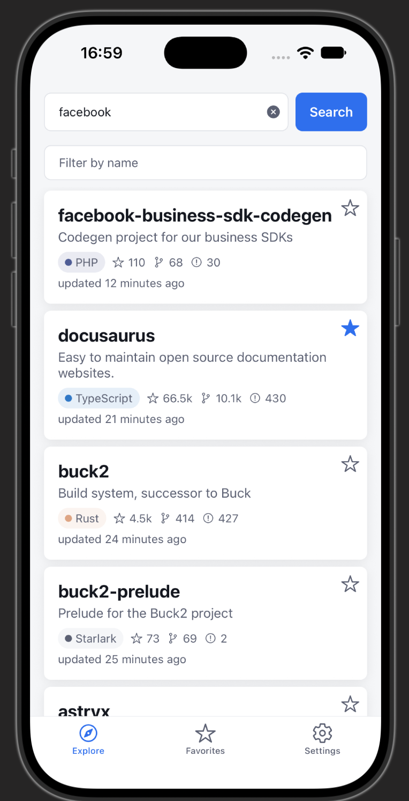
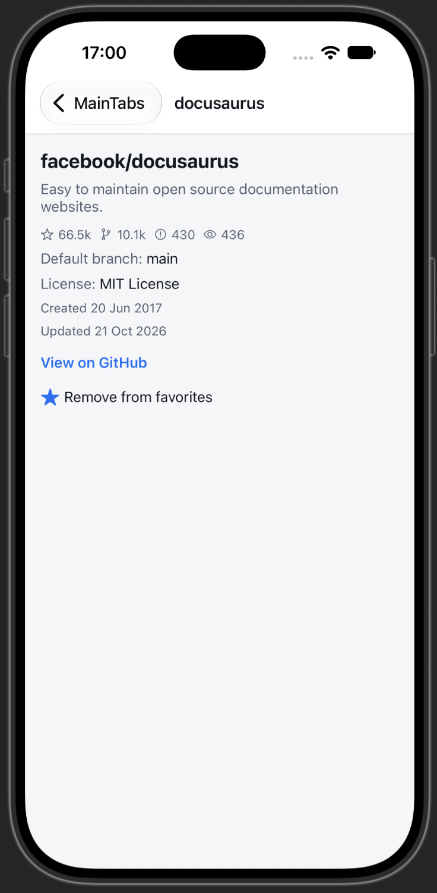
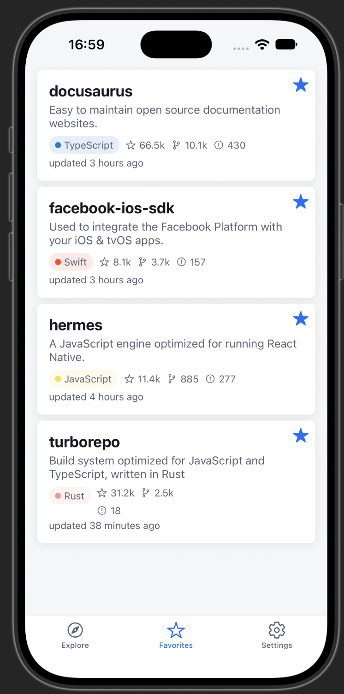
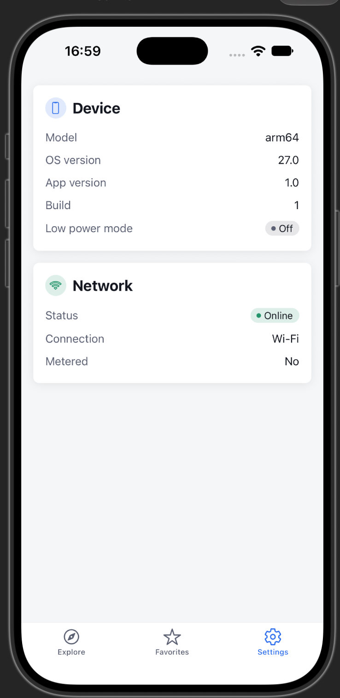

# GitHub Explorer

A React Native **CLI** app (no Expo) that explores public GitHub organizations through the public
GitHub REST API. Type an org (`facebook`, `vercel`, …), browse its repositories in an infinite list,
filter them by name, open a details screen, and mark favorites that survive restarts — including
while offline.

Built as a React Native Tech Lead home assignment. The emphasis is on **architecture that scales**
(clear separation of server state, client state and persistence), a **real TurboModule** the app
genuinely depends on, tests shipped with every milestone, and transparent use of AI.

| Doc                                | What's in it                                                      |
| ---------------------------------- | ----------------------------------------------------------------- |
| [`docs/DESIGN.md`](docs/DESIGN.md) | The design and source of truth — architecture, API, every section |
| [`DECISIONS.md`](DECISIONS.md)     | Why it's built this way, and what changed during the build        |
| [`AI_USAGE.md`](AI_USAGE.md)       | How AI was used, what it caught, where a human was needed         |
| [`docs/steps/`](docs/steps/)       | One plan per milestone (goal, files, test list, deviations)       |
| [`docs/ai-log.md`](docs/ai-log.md) | Raw per-milestone AI log — the source for `AI_USAGE.md`           |

---

## Features

- **Explore** — search a public org, infinite-scrolling repo list (`per_page=30`, `sort=updated`),
  pull-to-refresh, client-side name filter.
- **Repo details** — stars, forks, watchers, open issues, default branch, license, created/updated
  dates, and a link out to the repository. Prefetched on press-in, so it opens instantly.
- **Favorites** — stored as full repo snapshots, so the tab works with no network and no extra API
  calls. Survives app restarts (MMKV).
- **Offline** — the React Query cache is persisted to MMKV, so the last successful data is still
  there on a cold launch. A banner explains what you're looking at and when it was fetched.
- **Device & network** — a custom `DeviceNetwork` TurboModule (Kotlin + Swift) drives the offline
  state and is shown live in **Settings → Device**.
- **Light & dark** themes, following the system setting.
- **Graceful errors** — network, 404 and GitHub rate-limit errors are distinguished and handled
  differently; a mid-list failure never throws away the list you already paid for.

### Requirements

- Node **22** (see `.nvmrc`)
- Ruby + Bundler for CocoaPods (iOS)
- Xcode (iOS) / Android Studio + SDK (Android)

> **Note on the GitHub rate limit:** unauthenticated API access is capped at **60 requests/hour**
> per IP. The app treats this as a first-class error state (clear message + reset time, no automatic
> retry) rather than a generic failure — but you can hit it while exploring. Caching, a 5-minute
> `staleTime` and the persisted cache all exist partly to spend that budget carefully.

## Screenshots

| Explore                                                                                | Repo details                                                         | Favorites                                                               | Settings → Device                                                                                                  |
| -------------------------------------------------------------------------------------- | -------------------------------------------------------------------- | ----------------------------------------------------------------------- | ------------------------------------------------------------------------------------------------------------------ |
|  |  |  |  |

## Setup

```sh
npm install
cd ios && bundle install && bundle exec pod install && cd ..   # iOS only, macOS + Xcode required
```

## Run

```sh
npm start           # Metro bundler
npm run ios         # iOS simulator
npm run android     # Android emulator
```

The app uses the **New Architecture** (required for the TurboModule). If you change
`specs/NativeDeviceNetwork.ts`, rebuild the native app so Codegen re-runs — a JS-only reload won't
pick it up.

> Development was done against the **iOS simulator**. The Android build has since been run on an
> emulator (Pixel 9, API 37) with the native network path exercised end to end — toggling the
> emulator's connectivity drives `NetworkCallback.onLost` through to the offline banner. That run is
> also what surfaced a missing `ACCESS_NETWORK_STATE` permission: `registerDefaultNetworkCallback`
> and `getActiveNetwork` both require it, so both of the module's network methods
> (`startNetworkMonitoring`, `getNetworkState`) would have thrown `SecurityException` on Android. It's declared now, and the Kotlin module rejects its promises
> rather than throwing if it ever goes missing again. The rest of the app's flows (search →
> details → favorites across a restart) still have more simulator time on iOS than on Android.

### DevTools

Running `npm start` and opening React Native's built-in DevTools gets you two extra panels, courtesy
of [Rozenite](https://www.rozenite.dev/) — no setup, no flag:

- **TanStack Query** — live query/mutation cache, refetch/invalidate/clear.
- **Zustand** — live state for every registered store (`favorites`, `network`).

Both are verified dev-only (checked in each package's own shipped code, not just its docs): they
no-op when `NODE_ENV` is `'production'`, same as the app's own `logger.warn`/`.info`.

## Checks

```sh
npm run lint        # ESLint
npm run typecheck   # tsc --noEmit
npm test            # Jest
```

All three run in CI (GitHub Actions) on every PR and must pass before a merge. Husky + lint-staged
also format and lint staged files on commit.

---

## Architecture at a glance

Three state tools, one job each — this split is the core architectural idea:

| Tool            | Owns             | Examples                               |
| --------------- | ---------------- | -------------------------------------- |
| **React Query** | **server** state | repo lists, repo details, pagination   |
| **Zustand**     | **client** state | favorites, online status               |
| **MMKV**        | **persistence**  | favorites store, persisted query cache |

Server data lives in React Query only and is never copied into Zustand. See
[`DECISIONS.md`](DECISIONS.md) for why.

```
src/
├── app/                  # App.tsx, providers, navigation, app-level hooks
├── features/
│   ├── repos/            # api · hooks · components · screens   (Explore, RepoDetails)
│   ├── favorites/        # store · hooks · components · screens
│   ├── device/           # native (TurboModule wrapper) · store · hooks · components
│   └── settings/         # screens
└── shared/               # api · storage · components · hooks · utils · theme · logger
specs/                    # NativeDeviceNetwork.ts — Codegen spec
android/…/devicenetwork/  # Kotlin implementation
ios/DeviceNetwork/        # Swift + ObjC++ implementation
```

**Rules the code follows** (enforced by review, documented in `CLAUDE.md`):

- Dependencies flow one way: `screens → hooks → api/store → shared`. Features import each other only
  through `index.ts`.
- Screens hold no fetch logic; components are presentational (props in, callbacks out).
- GitHub DTOs never leave `api/` — `mappers.ts` converts them to domain models.
- Styles via `makeStyles(theme => …)` + `useStyles()`; no inline style objects, no hard-coded colors.
- Path aliases `@app/*`, `@features/*`, `@shared/*`, `@specs/*` — no deep relative imports.
- TypeScript `strict`, no `any`.

### The `DeviceNetwork` TurboModule

A real TurboModule (Codegen spec → typed Kotlin + Swift), not a demo. Every method is async; it
exposes `getNetworkState`, `getDeviceInfo`, `isLowPowerMode`, `start`/`stopNetworkMonitoring`, and a
typed `onNetworkStatusChanged` event. Each event updates both the Zustand network store **and**
React Query's `onlineManager` — which is what makes queries pause while offline and resume on
reconnect, instead of burning retries.

## Tests

Tests sit next to the code (`Foo.tsx` + `Foo.test.tsx`) and cover success, loading, error and empty
paths — utils, API/error mapping, stores, hooks (`renderHook` with a fresh `QueryClient`), and
components/screens via React Native Testing Library, which queries by role and label so the tests
double as accessibility checks.

Two of the most instructive bugs in this project were ones the suite **structurally could not**
catch, because every test mocks MMKV and the native module: a stale native build that broke MMKV
persistence, and React Query _pausing_ (not failing) a query while offline, which left an offline
search spinning forever. Both were found by running the real app. See [`AI_USAGE.md`](AI_USAGE.md).

## Scope

Deliberately **not** built, to keep the time box honest — each was considered and is written up in
`docs/DESIGN.md` rather than silently dropped:

- **Theme picker** (`system | light | dark` in Settings) — the themes and tokens are fully built and
  the app follows the system setting; the persisted user override isn't wired up (§9).
- **Deep linking** (`githubexplorer://repo/:owner/:repo`) — route params are already IDs only and
  serializable, so the screen is deep-link-_ready_; the `linking` config isn't registered (§6.1).
- **Auth, private repos, write operations**; pixel-perfect design; E2E tests.
- **i18n** — planned via `i18next` + `react-i18next` with RTL support through `I18nManager`
  (§18 has the specifics, including the handful of style properties an RTL pass would convert).
- **`.env` configuration** — not needed yet: the app calls one unauthenticated read-only API and
  holds no secrets. Planned via `react-native-config` once there's a Sentry DSN or a local-dev
  GitHub token to hold (§18, including why a bundled token is never actually secret).
- **Full CI/CD with Fastlane** — today's CI runs lint/typecheck/test only; it never produces a
  signed native build. Planned: automated signing, build-number bumps, and delivery to TestFlight /
  the Play Store internal track from GitHub Actions (§18).

Also see `docs/DESIGN.md` §17 (monitoring in production), §18 (future work) and §19 (risks and
trade-offs).
